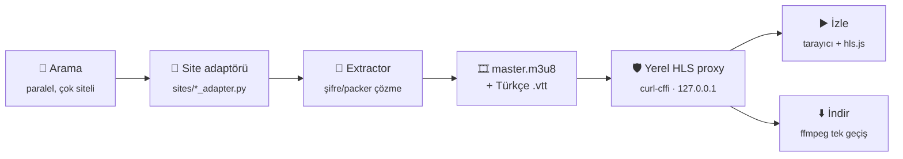

<div align="center">

# 👻 hayalet

**Tarayıcısız (headless), saf Python bir terminal aracı.**
Beş Türkçe yayın sitesinde aynı anda arar, sezon/bölüm gezer, `m3u8` akışını ve
Türkçe altyazıyı çözer — sonra **tarayıcıda izletir** veya **ffmpeg ile indirir**.
Aynı çekirdek bir de **Android uygulaması** olarak paketli.


</div>

---

## İçindekiler

| | | |
|---|---|---|
| [⚖️ Yasal uyarı](#️-yasal-uyarı) | [✨ Ne yapar](#-ne-yapar) | [🚀 Kurulum](#-kurulum) |
| [🕹️ Kullanım](#️-kullanım) | [🌐 Desteklenen siteler](#-desteklenen-siteler) | [⚙️ Nasıl çalışır](#️-nasıl-çalışır) |
| [🧩 Yeni site eklemek](#-yeni-site-eklemek) | [👥 Birlikte izle (oda)](#-birlikte-izle-oda) | [📱 Android uygulaması](#-android-uygulaması) |
| [🩹 Sorun giderme](#-sorun-giderme) | [🧪 Geliştirme ve testler](#-geliştirme-ve-testler) | [🗺️ Depo haritası](#️-depo-haritası) |

---

## ⚖️ Yasal uyarı

Bu proje **kişisel ve eğitim amaçlıdır**; bir tarayıcının halka açık bir web sayfasında zaten
yapabileceği istekleri (arama, sayfa gezme, oynatıcının kendi yüklediği akışı çekme) otomatikleştirir.
Hiçbir video/altyazı dosyasını barındırmaz, depolamaz veya yeniden dağıtmaz — yalnızca kaynak sitenin
sunduğu genel-erişimli akışa yerel olarak bağlanır.

Eriştiği hiçbir kaynak siteyle **bağlantısı veya ortaklığı yoktur**. İçerik üzerindeki tüm haklar ilgili
hak sahiplerine aittir. Bu aracı kullanmak, bulunduğun ülkenin telif hakkı ve ilgili mevzuatına uyma
sorumluluğunu **sana** yükler; geliştirici(ler) araçtan doğabilecek herhangi bir kullanım için sorumluluk
kabul etmez. Proje **"olduğu gibi"**, hiçbir garanti verilmeksizin sunulur.

> DRM'li kaynak eklenmez, coğrafi sınırlama aşılmaz — bu projenin kuralı (bkz. `kanal-notlari.md`).

---

## ✨ Ne yapar

| | Özellik | Ayrıntı |
|:--:|---|---|
| 🔎 | **Tek aramada beş site** | `--site` verilmezse bütün siteler **paralel** aranır; sonuçlar hangi siteden geldiği etiketiyle tek listede, tekrarlar birleştirilmiş olarak gelir. |
| 🧠 | **Toleranslı arama** | Siteler harfi harfine eşleştiriyor (`spiderman` → sıfır sonuç, `spider-man` → dolu). Sorgu zayıf sonuç verirse alternatif yazımlar (bileşik ayırma, Türkçe karakter katlama, gürültü kelime atma) **paralel** denenir, birleştirilip sıralanır. |
| 🎬 | **İzleme** | Yerel proxy'nin sunduğu hls.js sayfası varsayılan tarayıcıda açılır: ⚙ menüsünden kalite / ses / altyazı + altyazı boyut-renk-arka plan; `f` tam ekran, boşluk oynat-duraklat, ok tuşları sar/ses. |
| ⬇️ | **İndirme** | ffmpeg **tek geçişte** en yüksek kalite videoyu + bütün ses kanallarını (+ Türkçe altyazıyı softsub) mux'lar; canlı yüzde/hız göstergesi. |
| 🔤 | **Türkçe altyazı** | Ayrı dosya değil: master playlist'e **HLS `SUBTITLES` kanalı** olarak enjekte edilir, her oynatıcı native görür. |
| 🔊 | **Çift ses** | Dizipal'de dublaj ve orijinal sürüm ayrı ayrı çözülüp **tek akışta** birleştirilir (orijinal video + [Türkçe dublaj, orijinal ses] + altyazı). |
| ✅ | **Bölüm doğrulama** | Akışın süresi TVMaze/IMDb'deki bölüm süresiyle karşılaştırılır; tutmuyorsa (kırpılmış/yanlış kaynak) uyarır ve **diğer sitelerde tam bölümü** arar. |
| 🔁 | **Kaldığın yerden devam** | Son izlenen dizi/bölüm ve saniye konumu `.cache/prefs.json`'a yazılır, açılışta sorulur. |
| 🩺 | **Canlı sağlık kontrolü** | `--doctor`: her site için domain → arama → bölüm listesi → uçtan uca extract zincirini test eder. "Site mi bozuldu, kod mu bozuldu" sorusunu yanıtlar. |
| 🛡️ | **Anti-bot duruşu** | curl-cffi TLS/JA3 taklidi, her koşumda rastgele cihaz/tarayıcı personası, jitter'lı yeniden deneme, isteğe bağlı `--tor`, Cloudflare sınaması için `--cf-cookie`. |
| 👥 | **Birlikte izle** | Repo içinde bir oda sunucusu: senkron oynatma, sohbet, görüntülü görüşme, davet linki (şu an **Android'den** ayağa kalkıyor). |
| 📺 | **TV'ye yansıtma** | Chromecast için anahtar korumalı yerel ağ kapısı (`cast_gateway.py`) — proxy'yi tüm ağa açmadan. |
| ⭐ | **IMDb** | Anahtarsız uçlardan puan, özet, tür, süre, oyuncu, fragman ve "en popüler" listeleri (Android ana sayfa rafları). |
| 📱 | **Android** | Aynı Python çekirdeği, native bir arayüz ve ExoPlayer ile APK olarak. |

---

## 🚀 Kurulum

```bash
cd hayalet
python -m venv venv
venv\Scripts\activate            # Windows (PowerShell: venv\Scripts\Activate.ps1)
pip install -r requirements.txt
```

<table>
<tr><th align="left">Kurulum biçimi</th><th align="left">Çalıştırma</th></tr>
<tr>
<td><code>pip install -r requirements.txt</code></td>
<td><code>python -m hayalet</code> &nbsp;·&nbsp; <code>baslat.bat</code></td>
</tr>
<tr>
<td><code>pip install -e .</code> &nbsp;<em>(önerilen)</em></td>
<td>Her yerden sadece <code>hayalet</code> — konsol komutu oluşur</td>
</tr>
<tr>
<td><code>pip install -e ".[test]"</code></td>
<td>Yukarıdakiler + <code>pytest</code></td>
</tr>
<tr>
<td><code>pip install -e ".[oda]"</code></td>
<td>Yukarıdakiler + birlikte izleme sunucusu (socket.io, werkzeug, paramiko)</td>
</tr>
</table>

> [!WARNING]
> `pip install -e .` (editable) kurulumda kod **kopyalanmaz**, klasöre bağlanır. Proje klasörünü
> taşır ya da silersen `hayalet` komutu `ModuleNotFoundError: No module named 'hayalet'` verir;
> çözüm yeni yolda `pip install -e .` komutunu tekrarlamaktır.

### Sistem araçları

| Araç | Ne için | Zorunlu mu |
|---|---|---|
| **Bir tarayıcı** | İzleme (varsayılan tarayıcın otomatik açılır, ek kurulum yok) | İzlemek için |
| **ffmpeg** | İndirme/mux — PATH'te olmalı | İndirmek için |
| **Tor** | `--tor` ile yerel SOCKS (127.0.0.1:9050) | Hayır |

### Ortam değişkenleri

| Değişken | Varsayılan |
|---|---|
| `HAYALET_DOWNLOAD_DIR` | `~/Downloads` |
| `HAYALET_CACHE_DIR` | `<proje>/.cache` (domain + tercihler burada) |

---

## 🕹️ Kullanım

### İnteraktif menü (önerilen)

```bash
hayalet                    # veya: python -m hayalet
```

Akış: **ara → sonuç seç → İzle / İndir.**

```
         ┌──────────── dizi ────────────┐
ara ──▶ seç ──▶ sezon ──▶ bölüm(ler) ──▶ İzle / İndir
         └──────────── film ────────────┘   (bölüm sorulmaz)
```

* **Film** seçilirse sezon/bölüm adımı tamamen atlanır, doğrudan İzle/İndir çıkar.
* İndirmede **boşluk tuşuyla birden fazla bölüm** işaretlenebilir.
* `--site` verilmezse arama **bütün sitelerde aynı anda** yapılır; hangi sitede olduğunu düşünmene
  gerek yok. Tek siteye sabitlemek için: `hayalet --site dizipal`.
* İndirmeden önce **hedef ana klasör sorulur** (varsayılan: son kullanılan, yoksa `Downloads`) ve
  bir sonraki sefer için hatırlanır.

> [!NOTE]
> İndirmeler her zaman **mevcut en yüksek kalitede** yapılır; kalite sorusu yok.
> `--quality` yalnızca `--action extract` çıktısını etkiler.

### Komut satırı (script / otomasyon)

```bash
hayalet --search "house of the dragon"                                  # sonuçları indeksle listele
hayalet --search "..." --series 1 --season 1 --episode 1 --action extract
hayalet --search "..." --series 1 --season 1 --episode 1 --action watch
hayalet --search "..." --series 1 --season 1 --episodes 1,2,3 --action download
hayalet --site hdfilmcehennemi --search "matrix" --series 0 --action watch   # film
hayalet --doctor                                                        # canlı sağlık kontrolü
```

<details>
<summary><strong>Bütün bayraklar</strong></summary>

| Bayrak | Ne yapar |
|---|---|
| `--site {dizipal,diziyou,fullhdfilmizlesene,hdfilmcehennemi,webdramaturkey}` | Siteyi sabitler. Verilmezse: interaktif modda **hepsi**, `--search` otomasyonunda **dizipal**. |
| `--domain URL` | Resolver'ı atlar, adresi elle verir. Yalnızca `--site` ile anlamlı. |
| `--search METİN` | Arama sorgusu (non-interaktif mod). |
| `--series N` | Arama sonucu indeksi. |
| `--season N` / `--episode N` | Sezon / tek bölüm. |
| `--episodes 1,2,3` | Çoklu bölüm. |
| `--quality best\|worst\|1080\|720…` | Yalnızca `extract` çıktısı için. Verilmezse son kullanılan hatırlanır. |
| `--action extract\|watch\|download` | `extract` en ucuzu: yalnızca ağ, oynatıcı/ffmpeg yok — zincir sağlam mı diye bakmanın en hızlı yolu. |
| `--doctor` | Her site için domain/arama/bölüm/extract zincirini canlı test eder; diğer bayraklar yoksayılır. |
| `--tor` | Trafiği yerel Tor SOCKS'una verir; Tor kapalıysa uyarıp normale döner. |
| `--cf-cookie "cf_clearance=…"` | Cloudflare JS sınamasını aşmak için tarayıcıdan alınan cookie. `--user-agent` **zorunlu**. |
| `--user-agent "…"` | UA'yı sabitler (persona rotasyonunu kapatır). |
| `--no-cache` | Önbelleğe alınmış domaini yoksayar. |

</details>

### İndirme konumu

Seçilen ana klasörün altında:

```
<ana klasör>/
├── Breaking Bad/                      # DİZİ → tek klasörde toplanır
│   ├── Breaking Bad - S01E01.mkv
│   └── Breaking Bad - S01E02.mkv
└── The Matrix.mkv                     # FİLM → tek dosya, klasör açılmaz
```

Kapsayıcı: tek ses varsa `mp4`, çoklu ses ya da altyazı varsa `mkv` (`language=tur` etiketli).

---

## 🌐 Desteklenen siteler

| Site | İçerik | Çıkarım şeması | Not |
|---|---|---|---|
| **Dizipal** | Dizi + film | Şifreli `data-rm-k` (CryptoJS AES + PBKDF2-SHA512) → iframe → `source2.php` → `master.m3u8` | Domain sürekli değişir → **dinamik resolver**. Dublaj/orijinal ayrı sürümler tek akışta birleştirilir. |
| **hdfilmcehennemi.nl** | Film + dizi | `/rplayer/` sayfasındaki **packer**'lanmış + "unmix" ile karıştırılmış JS çözülür | Karıştırma şeması iki nesil gördü; sayfa her yüklemede farklı adım sırası üretiyor. 1080p + çift ses. |
| **diziyou.one** | Dizi | Adaptörün kendi içinde | — |
| **fullhdfilmizlesene.now** | Film | Adaptörün kendi içinde | — |
| **webdramaturkey2.com** | Dizi | Adaptörün kendi içinde | — |

> Türk dizisi kapsamını kanalların kendi ücretsiz/yasal yayınlarıyla genişletme yoklamaları
> `kanal-notlari.md`'de (Kanal D, Show TV, ATV, Star TV, TLC, DMAX, TRT Çocuk — henüz adaptör yazılmadı).

---

## ⚙️ Nasıl çalışır



1. **Anti-bot bypass** — `curl-cffi` gerçek Chrome TLS/JA3 imzasını taklit eder; standart `requests`
   bu sitelerden (sayfalar, API'ler, hatta **afiş CDN'i**) düz 403 yer.
2. **Dinamik domain resolver** *(Dizipal'e özel)* — güncel `dizipalXXXX.com` adresini bulur. Aday aralığı
   **paralel** taranır ve bir adres ancak **arama ucu gerçek JSON döndürürse** kabul edilir: bloklu
   bölgelerde erişilebilen adres çoğu zaman her yola aynı HTML'i veren bir **ön-yüz aynası**dır.
   Doğrulanmadan `.cache/domain.json`'a hiçbir şey yazılmaz.
3. **Arama** — site API'si (Dizipal'de `POST /bg/searchcontent`) + `core/query.py`'nin tolerans katmanı:
   yazım varyantları, skor + kapsama süzgeci, siteler arası tekrar birleştirme.
4. **Extractor** — siteye göre şifreli JSON çözme veya packer/unmix açma → gerçek `master.m3u8` ve
   Türkçe altyazı. Dizipal'de dublaj + orijinal `merge.py`'de tek `MergedStream`'e katlanır.
5. **Yerel proxy** — master'da ses ayrı kanaldır, segmentler `.jpg` gibi gizlenir ve CDN TLS taklidi
   olmayan istemcileri (tarayıcı/ffmpeg) 403'ler. Çözüm: localhost'ta bir proxy; playlist URL'leri ona
   yönlendirilir, segmentler `.ts` olarak sunulur, her istek curl-cffi ile çekilir, Türkçe altyazı
   master'a HLS kanalı olarak enjekte edilir.
6. **Doğrulama** — çözülen akışın süresi TVMaze/IMDb bölüm süresiyle karşılaştırılır; sapma varsa
   (kırpılmış/yanlış kaynak) uyarılır ve çoklu site modunda **otomatik olarak** diğer sitelerde tam
   bölüm aranır.
7. **Aksiyon** — **İzle:** hls.js sayfası tarayıcıda açılır. **İndir:** ffmpeg en yüksek kalite
   varyantını + bütün sesleri (+ softsub) tek geçişte mux'lar.

<details>
<summary><strong>Ölü dublaj kaynakları → otomatik fallback</strong></summary>

Bazı **"Türkçe Dublaj"** sürümleri park edilmiş bir host'a gider: CHEQ interstitial → RTB reklam →
domain-parking zinciri. Bu anti-bot **değildir** — arkasında gerçekten video yoktur (tarayıcı da
açamaz, park reklamı görür).

Araç bunu tanıyınca (`DeadSourceError`) aynı içeriğin **orijinal/altyazılı** sürümüne geçer ve bildirir:

> *Dublaj kaynağı ölü → orijinal/altyazılı sürüme geçildi: Loki (S1E1)*

**Dürüst not:** bu, dublaj sesi yerine **orijinal ses + Türkçe altyazı** verir; dublaj sesi kaynakta
gerçekten yok. Muadili bulunamazsa net hata döner.

</details>

<details>
<summary><strong>Oynatıcı sayfasındaki (gözle görünmeyen) çözümler</strong></summary>

`core/proxy.py` içindeki oynatıcı şablonuna dokunmadan önce:

* Altyazılar `video::cue` ile değil **kendi `#capOverlay` div'imizle** çizilir (native cue stili
  tarayıcılar arasında güvenilmez ve ikisi birlikte çift altyazı üretiyordu).
* Video `focus` alınca `blur()` edilir — yoksa native `<video controls>` klavyeyi kapıp ok tuşlarını
  iki kat sarmaya çeviriyor.
* Native tam ekran düğmesi CSS ile gizli; tam ekran kendi düğmemizden/`f` ile `#wrap` üzerinde
  (native FS yalnız `<video>`'yu büyütüp menüyü/altyazıyı kaybediyor).
* Kontroller `:hover` değil **hareketsizlik sayacıyla** gizlenir (tam ekranda `:hover` hiç bitmiyor).

</details>

---

## 🧩 Yeni site eklemek

Ortak katmanlar (proxy, ffmpeg, arama toleransı, menü akışı) **hiç değişmez**; site başına tek dosya
yazılır.

```python
# hayalet/sites/yenisite_adapter.py
from hayalet.core.sites import register

class YeniSiteAdapter:
    name = "yenisite"
    def resolve_domain(self, net, session): ...   # base_url'ü belirle
    def search(self, net, session, q): ...        # -> list[Series]
    def suggest(self, net, session, q): ...       # "şunu mu demek istedin"
    def get_episodes(self, net, session, s): ...  # -> list[Episode]
    def build_stream(self, net, session, ep, s):  # -> MergedStream
        ...

register(YeniSiteAdapter())
```

`sites/__init__.py` modülü import eder, `--site` seçenekleri otomatik büyür. `home_rows` / `browse`
**isteğe bağlıdır** (ana sayfa rafları ve "Diziler/Filmler" sekmeleri için) — yazmayan site atlanır,
boş gövde gerekmez.

---

## 👥 Birlikte izle (oda)

Telefon/tablet (ya da PC) küçük bir sunucu olur, arkadaşlar **davet linkini tarayıcıda** açıp katılır;
oynatma, sohbet ve görüntülü görüşme herkeste senkron (ölçüldü: iki taraf arasında 0,00 sn fark).

| Parça | Ne yapar |
|---|---|
| `oda/server.py` | WSGI + werkzeug: sayfa, `/api/proxy`, `/api/img`, socket.io |
| `oda/events.py` | socket.io olayları: katılma, senkron, sohbet, yetki, öneri, katalog, WebRTC sinyali |
| `oda/rooms.py` | Saf oda modeli (kişiler, lider, kumanda modu, öneriler, sohbet geçmişi) |
| `oda/catalog.py` | Odanın içinden arama/bölüm/akış çözme — istemciye yalnız opak `ref` gider |
| `oda/proxy_api.py`, `manifest.py`, `guard.py` | Video proxy'si, playlist yeniden yazımı, SSRF süzgeci |
| `oda/cloudflared.py`, `tunnel.py` | Uzaktan erişim: ana yol cloudflared hızlı tünel, yedek SSH |
| `oda/web/` | Derleme adımı olmayan oda sayfası (`oda.js`, `player.js`, `call.js`, …) |

**Yetki:** *ev sahibi* içerik koyar, öneriyi onaylar, kişi çıkarır, kumanda modunu seçer; *kumanda modu*
(`all` / `host`) kimin oynatıp sarabileceğini belirler; *misafir* önerir, izler, konuşur. Sohbetteki ad ve
renk sunucudaki kayıttan gelir — istemcinin bildirdiği ada güvenilmez.

> [!IMPORTANT]
> Oda şu an **Android uygulamasından** (`OdaService`) ayağa kalkıyor; masaüstünde CLI bayrağı yok,
> elle bir `OdaServer(...)` kurmak gerekir. Bağımlılıklar: `pip install -e ".[oda]"` —
> bu olmadan `hayalet.oda.server` **import edilemez**.
> Mimari ve ölçülmüş tuzakların tamamı: **[`oda-notlari.md`](oda-notlari.md)**.

---

## 📱 Android uygulaması

Aynı boru hattını telefonda kullanan native bir uygulama: site başına ana sayfa rafları + IMDb
"popüler" rafları + "kaldığın yerden devam", çoklu site arama, sezon/bölüm gezinme, **ExoPlayer**
oynatıcı (dokunulan noktaya göre yakınlaştırma, PiP, kulaklık/Bluetooth medya tuşları), **Chromecast**
ile TV'ye yansıtma, arka planda indirme (ön plan servisi) ve kartta uzun basmayla hızlı eylemler
(kaldır / diziye git). Arayüz tamamen kodla çizilir — XML layout yok (`Ui.java`); Python tarafı
(`hayalet_app.py`) iş mantığı barındırmayan ince bir JSON köprüsüdür.

Proje **ayrı çalışma klasöründe**: `C:\Users\Public\hayalet-android`
Python kaynağı bu deponun `hayalet/` klasörüyle **junction** üzerinden ortaktır — buradaki Python
değişikliği doğrudan APK'nın kaynağını değiştirir, kopyalama adımı yoktur.

| Gereksinim | Yol |
|---|---|
| Android SDK | `C:\Users\Public\android\sdk` |
| Java 17 | `C:\Users\Public\android\jdk\jdk-17.0.20+8` |
| Gradle 8.9 | `C:\Users\Public\android\gradle\gradle-8.9` |
| Telefon | Aynı ağda + **Geliştirici seçenekleri → Kablosuz hata ayıklama** açık |

<details>
<summary><strong>APK derleme ve telefona kurulum (PowerShell)</strong></summary>

```powershell
$env:JAVA_HOME = "C:\Users\Public\android\jdk\jdk-17.0.20+8"
Set-Location "C:\Users\Public\hayalet-android"
& "C:\Users\Public\android\gradle\gradle-8.9\bin\gradle.bat" clean assembleDebug
```

Çıktı: `C:\Users\Public\hayalet-android\app\build\outputs\apk\debug\app-debug.apk`

Telefonun kablosuz hata ayıklama ekranındaki IP ve portu kullan — **port her seferinde değişir**:

```powershell
$adb = "C:\Users\Public\android\sdk\platform-tools\adb.exe"
$serial = "192.168.1.46:46041"
$apk = "C:\Users\Public\hayalet-android\app\build\outputs\apk\debug\app-debug.apk"

& $adb start-server
& $adb connect $serial
& $adb devices
& $adb -s $serial install -r --streaming $apk
& $adb -s $serial shell am force-stop com.hayalet.test
& $adb -s $serial shell monkey -p com.hayalet.test 1
```

`install` çıktısı **Success** olmalı. Bağlantı reddedilirse telefondaki kablosuz hata ayıklamayı
kapat-aç, ekrandaki yeni portu kullan. Kurulumdan sonra **eski APK'yı güncel sanma**, doğrula:

```powershell
& $adb -s $serial shell dumpsys package com.hayalet.test |
    Select-String "versionName|lastUpdateTime"
```

Python değişikliğinin APK'ya gerçekten girmesi için `clean assembleDebug` şart.

</details>

---

## 🩹 Sorun giderme

| Belirti | Sebep | Çözüm |
|---|---|---|
| `hayalet` komutu `ModuleNotFoundError` veriyor | editable kurulum silinen/taşınan klasörü gösteriyor | Yeni yolda `pip install -e .` |
| "domain bulunamadı" (Dizipal) | Adres bütün tarama penceresinin dışına atladı | `config.py > KNOWN_DOMAIN`'i güncelle ya da `--domain` ile elle ver |
| Arama `JSONDecodeError` / boş dönüyor | Erişilen adres bir **ön-yüz aynası** | `--no-cache` ile yeniden çöz; resolver aynayı tanıyıp gerçek origin'i dener |
| "Just a moment…" / Cloudflare sınaması | TLS taklidi JS sınamasını geçemez | Tarayıcıdan `cf_clearance` al: `--cf-cookie "cf_clearance=…" --user-agent "<tarayıcının UA'sı>"`. **Bir kez** verilir, host başına `prefs.json`'a yazılır; süresi geçince program yeniden ister. |
| Her şey 403 | IP/bölge engeli ya da **açık VPN** | Önce VPN'i (ör. WARP) kapat; sonra `--tor` dene |
| Dublaj sesi gelmiyor | Dublaj kaynağı ölü/park edilmiş domain | Otomatik olarak orijinal ses + Türkçe altyazıya düşer — kaynakta dublaj gerçekten yok |
| Bölüm süresi kısa/yanlış görünüyor | Kaynak kırpılmış | Doğrulayıcı uyarır; çoklu site modunda diğer siteler denenir |
| İndirme başlamıyor | ffmpeg PATH'te değil | ffmpeg kur / PATH'e ekle |
| Site tamamen bozuk mu, kod mu? | — | `hayalet --doctor` (ya da `--site X --doctor`): canlı zincir testi |
| Türkçe karakterler bozuk | Konsol kod sayfası | `baslat.bat` kullan (UTF-8 zorlar) |

Çözüm aşamasında hata şu ikisini **ayırır**: `BlockedError` (403/429/503 — yeniden denenir) ve
`ChallengeError` (Cloudflare JS sınaması — **hiç** yeniden denenmez, çünkü TLS taklidiyle geçilemez).
Teşhisi karıştırmamak için bu ayrım bilinçli.

---

## 🧪 Geliştirme ve testler

```bash
pip install -e ".[test]"
pytest                     # 12 test dosyası, tamamı ağsız
hayalet --doctor           # canlı: site gerçekten hâlâ böyle mi çalışıyor?
```

| Katman | Ne cevaplar | Araç |
|---|---|---|
| **Birim testleri** (`tests/`) | "Bizim kod mu bozuldu?" — kriptografi (gerçek, donmuş fixture'lara karşı), bölüm eşleştirme, m3u8 ayrıştırma, arama normalizasyonu/sıralaması, resolver (sahte bellek-içi internete karşı), oda yetkileri | `pytest` |
| **Canlı kontrol** | "Site mi bozuldu?" — domain, arama, bölüm listesi, uçtan uca extract | `--doctor` |
| **En ucuz elle doğrulama** | Çıkarım zinciri sağlam mı (oynatıcı/ffmpeg yok, yalnız ağ) | `--action extract` |
| **Oynatıcı sayfası** | Menü, klavye, altyazı çizimi | JS'i `node --check`, davranış için geçici Playwright (proje bağımlılığı **değil**) |

Lint ya da derleme adımı yoktur.

> [!TIP]
> **Dizipal için tek doğruluk kaynağı `config.py`'dir** — site değişince kod değil config düzenlenir:
> `RMK_PASSPHRASE` / `RMK_ITERATIONS` / `RMK_KEYSIZE` (şifre çözme parametreleri, sitenin JS bundle'ından
> çıkarılır), `SELECTORS` (doğası gereği kırılgan regex'ler), `KNOWN_DOMAIN`, `SEARCH_ENDPOINT`.
> Diğer siteler sabitlerini kendi adaptörlerinin içinde tutar.

---

## 🗺️ Depo haritası

```
hayalet/
├── cli.py                  # giriş noktası: bayraklar, interaktif akış, indirme kuyruğu
├── config.py               # Dizipal sabitleri + yollar (tek doğruluk kaynağı)
├── core/
│   ├── session.py          # tek kimlik: base_url, cookie, UA, impersonate, proxy
│   ├── network.py          # TEK HTTP katmanı (curl-cffi) — BlockedError / ChallengeError
│   ├── sites.py            # SiteAdapter protokolü + kayıt defteri + çok siteli arama/raf
│   ├── query.py            # toleranslı arama: varyantlar, skor, kapsama, sıralama (saf)
│   ├── models.py           # Series / Episode + saf liste yardımcıları
│   ├── catalog.py          # Dizipal kataloğu, dublaj↔orijinal eşleştirme, öneri
│   ├── extractor.py        # Dizipal kripto zinciri → master.m3u8 + .vtt
│   ├── merge.py            # dublaj + orijinal → tek MergedStream
│   ├── proxy.py            # yerel HLS proxy + hls.js oynatıcı sayfası ⭐ işin kalbi
│   ├── actions.py          # watch() / download() (ffmpeg tek geçiş)
│   ├── verifier.py         # TVMaze/IMDb süresi ile akış süresi karşılaştırma
│   ├── imdb.py             # anahtarsız IMDb: puan, özet, fragman, popüler listeler
│   ├── cast_gateway.py     # Chromecast için anahtar korumalı LAN kapısı
│   ├── m3u8_parser.py      # varyant/ses kanalı ayrıştırma (jenerik)
│   ├── menu.py             # questionary arayüzü
│   ├── resolver.py         # Dizipal dinamik domain taraması + ayna tespiti
│   ├── personas.py         # cihaz/tarayıcı parmak izi rotasyonu
│   ├── prefs.py            # .cache/prefs.json — kalite, devam kaydı, cf cookie
│   └── logs.py, utils.py   # kayıt + kripto/sezgisel yardımcılar
├── sites/                  # site başına BİR dosya (dizipal, hdfilmcehennemi, diziyou,
│                           #   fullhdfilmizlesene, webdramaturkey)
├── oda/                    # birlikte izleme: sunucu, senkron, proxy, tünel, web/
└── assets/hls.min.js       # yerel hls.js (CDN'e bağımlılık yok)

tests/                      # ağsız birim testleri + donmuş gerçek fixture'lar
kanal-notlari.md            # Türk TV kanalları yoklaması (henüz adaptör yok)
oda-notlari.md              # oda mimarisi + ölçülmüş tuzaklar
baslat.bat                  # Windows başlatıcı (UTF-8 zorlar, venv python'u kullanır)
```

<div align="center">
<sub>Kişisel ve eğitim amaçlı. Hiçbir içerik barındırılmaz, saklanmaz veya dağıtılmaz.</sub>
</div>
